<div align="center">




<!-- Gunakan garis divider biasa atau buat file divider.svg kustom jika mau -->
<hr style="border: 1px solid #dc2626; width: 80%; opacity: 0.5;">

### ✨ whoami


</div>

```java
public class Lalu M. Sulthan Azmy {
    String     name     = "Lalu M. Sulthan Azmy";
    String     vibe     = "Software Developer & Network Enthusiast 🛠️";
    String     focus    = "Frontend & seamless webs";
    List<String> stack  = List.of("Next.js", "C++", "Python", "Java", "JavaScript");
    List<String> tools  = List.of("VS code", "Github", "git");
    String     motto    = "Try Everything.";
}
