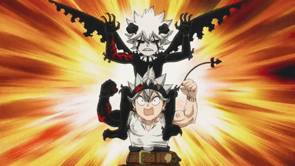

<div align="center">


<hr style="border: 1px solid #dc2626; width: 80%; opacity: 0.5; margin-top: -10px; margin-bottom: 5px;">

<h3 style="margin-top: 0px;">&gt; whoami</h3>



</div>

```java
public class SulthanAzmy {
    String       name     = "Lalu M. Sulthan Azmy";
    String       vibe     = "Web Developer & IoT Enthusiast 🛠️";
    String       focus    = "Frontend & seamless webs";
    List<String> stack    = List.of("Next.js", "C++", "Python", "Java");
    List<String> tools    = List.of("VS code", "Github", "git");
    String       motto    = "Try Everything.";
}
